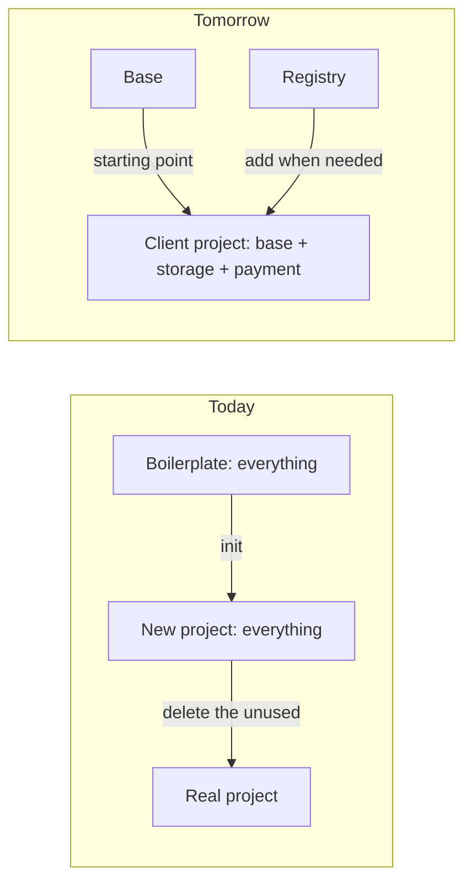
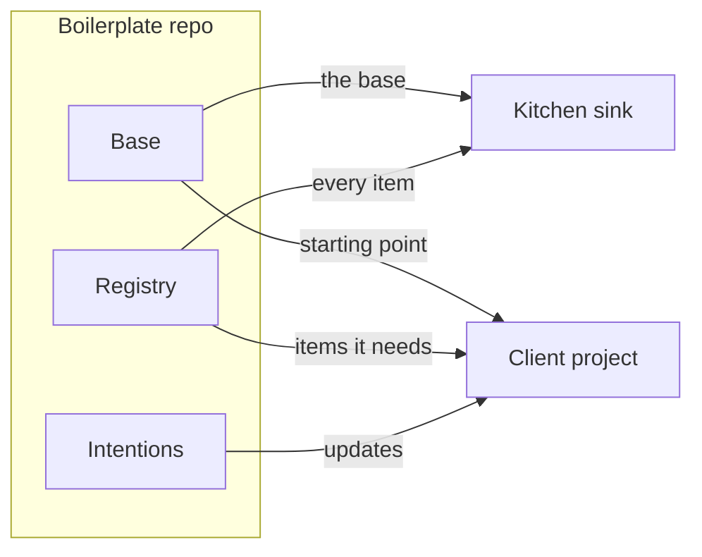
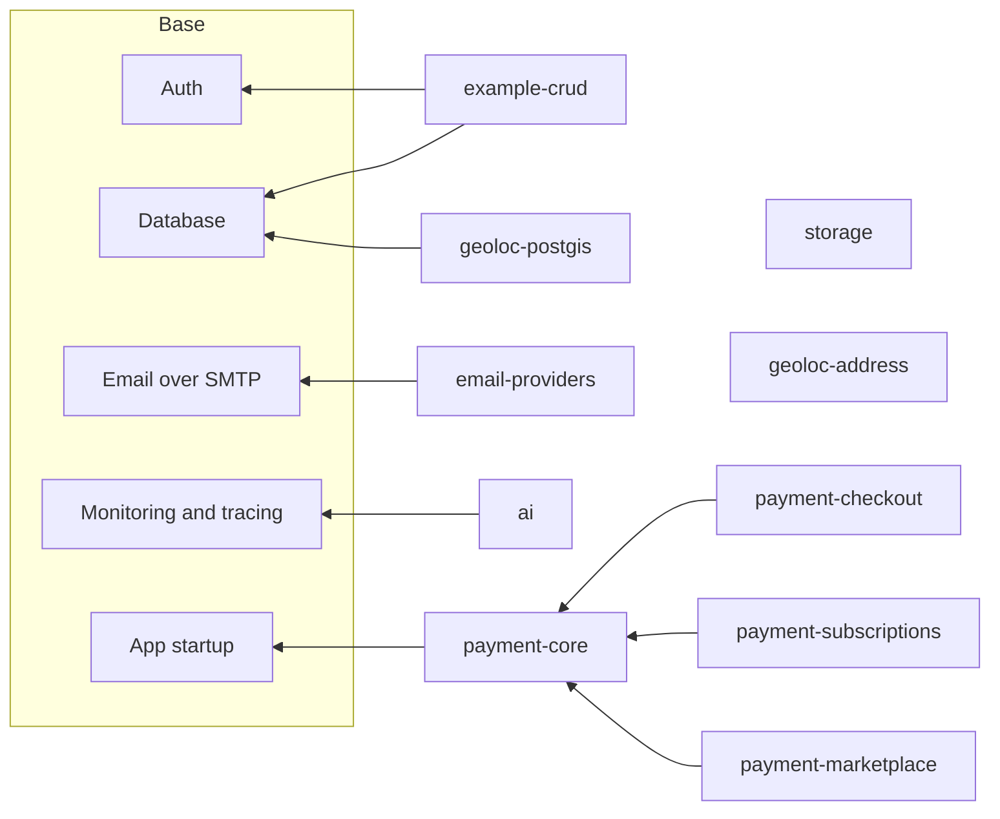
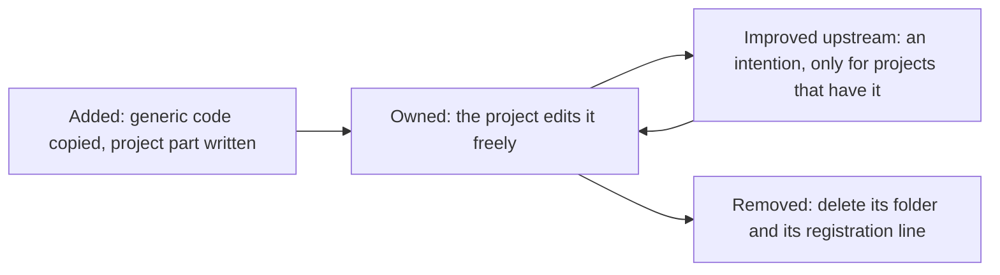
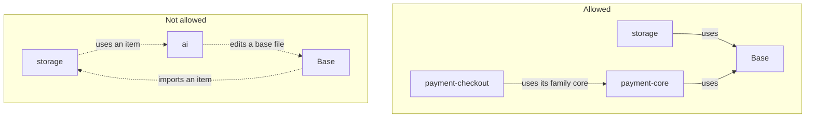

:::caution[Proposal]
This page describes a target architecture under discussion. Nothing here is built yet. It changes the "all-in-one" choice described in [Design philosophy](/lonestone-boilerplate/explanations/0_designphilosophy). That page will be updated once the registry exists.
:::

## The idea

Today every new project starts with everything: examples, AI, email, and more. Each team then deletes what it does not need. Removing code by hand is slow and error-prone, and projects keep dependencies they never use.

We want the opposite. A **small base** that every project gets. Next to it, a **registry** of features we build again and again for clients: file storage, payment, geolocation, AI. A project adds an **item** only when it needs it.



## The five pieces

| Piece | What it is |
| --- | --- |
| **Base** | What every project gets on day one. Only what almost every Lonestone project uses: sign-in, database, email sending, error monitoring. No examples. |
| **Registry** | A catalog of features we build again and again for clients. Each item is ready-made code plus install instructions. Items sit next to the base, in the same repo, but are not wired into it. |
| **Intentions** | Already exist (see [Boilerplate upgrades](/lonestone-boilerplate/explanations/7_boilerplate-upgrades)). They explain how to bring an improvement into code a project already has. With the registry, an improvement to an item reaches only the projects that added it. |
| **Kitchen sink** | A full project with the base and every item wired together. Nobody ships it. It proves that every item still works with the current base. |
| **Client project** | Starts from the base. Adds items one by one when the client needs them. Once added, the item's code belongs to the project. |



## Base and items

The base keeps sign-in, the database, email over SMTP, monitoring and tracing, and app startup. Email stays in the base because sign-up and password reset send emails.

Every item registers itself in the app. The table says what else it needs from the base. An item that needs nothing else stands alone. Items are API only for now.

| Item | What it does | Needs from the base |
| --- | --- | --- |
| `storage` | Upload and serve files on any S3-compatible service. | Nothing else |
| `email-providers` | Adds a provider's own API and email templates, behind the same email service. | Email |
| `payment-core` | Checks that a payment notification really comes from the provider, and handles each one only once. | App startup, to read notifications exactly as sent |
| `payment-checkout` | One-off payments. The order is marked paid when the provider confirms. | `payment-core` |
| `payment-subscriptions` | Recurring plans, kept in sync with the provider. | `payment-core` |
| `payment-marketplace` | Sellers get paid through the platform, which keeps a fee. | `payment-core` |
| `ai` | Today's AI module, moved out of the base: model calls, rate limits, LLM tracing. | Monitoring and tracing |
| `geoloc-address` | Turn an address into coordinates and back. | Nothing else |
| `geoloc-postgis` | Find what is near a point, inside the database. | Database |
| `example-crud` | Today's posts and comments examples. They show how we write a feature. | Auth, database |



### Hooks: how the base lets items in

The base never imports an item. Instead, it offers a few fixed places where an item can plug in. Each one exists because at least one item needs it.

| Hook | What an item can do there | Used by |
| --- | --- | --- |
| **Registration** | Register its module, in one place. | Every item |
| **Its own settings** | Read its own settings, without touching the base's settings file. | Every item |
| **App startup** | Read incoming requests exactly as they were sent. | `payment-core`, to check that a notification really comes from the provider |
| **Tracing** | Add its own tracing next to the base's. | `ai`, to send model calls to Langfuse |

When a new item needs something none of these offer, we add a hook to the base first. We do not let the item patch base files.

## Inside an item

Like shadcn, the code is copied into the project and then belongs to it. Unlike shadcn, part of a feature always depends on the client: which provider, who may do what, how it connects to the project's own data. An item says what that part is, and an agent writes it.

Take the storage item:

- **Copied as is.** The S3 client, uploads, signed links. The same for every project.
- **Written by an agent.** Which bucket, who may upload, which data owns a file ("a user has one avatar", "an invoice keeps its PDF"). The item cannot guess that. Its install instructions ask the question, and the agent writes the answer into the project.

| | Copies code | Adapts to the project | Remembered in the project |
| --- | --- | --- | --- |
| shadcn | Yes, all of it | No | No |
| Intentions (today) | No | Yes, all of it | Yes |
| **Registry items** | Yes, the generic part | Yes, the project part | Yes, so updates reach it |

### What an item contains

Every item has the same three parts, and nothing else:

```text
registry/storage/
  item.json     the item's card: its name, what it needs, its settings, its packages
  INSTALL.md    the install instructions: questions to ask, what to write, how to check it works
  files/        the ready-made code, laid out where it goes in a project
```

The install instructions follow the same idea as intentions: they describe the goal and the decisions, not a diff. That is what lets an agent fit the item into a project that has already moved away from the base.

### Items or intentions?

- An **item** adds something a project does not have yet.
- An **intention** changes something a project already has.
- An improvement to an item is an intention, marked with the item's name. Only projects that added the item receive it.

## The life of an item in a project



The project remembers which items it added, and from which release. That is how an improvement finds the right projects. Nothing is ever updated automatically: each improvement is read, accepted or skipped, then applied like any other intention.

## We choose the shape, not the vendor

Each item is firm on structure and safety. It ships with one reference provider, and its instructions ask which provider the client uses. It never wraps every provider behind one shared interface.

- **Storage.** One S3-compatible client. The same code works with AWS, Cloudflare R2, Scaleway, OVH, and MinIO on a laptop. Only the settings change.
- **Payment.** Three items share one core: one-off payments, subscriptions, marketplace. Stripe is the reference. We avoid one interface over Stripe, Mollie and PayPal: their checkouts and subscriptions differ too much, so the wrapper would hide what matters.
- **Email.** The base sends email over SMTP, which every provider accepts. The item adds a provider's own API and templates.

## Keeping it clean

A registry gets messy in predictable ways. Too many items. Items that depend on each other. Items that patch the base. Items nobody maintains. Each rule below blocks one of these.

### A clear place for everything

| Where | When | Example |
| --- | --- | --- |
| **Base** | Almost every project needs it. | Sign-in, database, email, monitoring |
| **Registry item** | Many projects need it, and most of the code is the same each time. | Storage, payment, geoloc, AI |
| **Docs guide** | Rare, or mostly different for each client. | Explained in this documentation, no ready-made code |

### Dependencies point toward the base



### The rules

1. **Earned, not invented.** An item enters only after we built the feature for real clients at least twice. Its code comes from those projects. Each item has an owner. An item nobody uses or maintains leaves the registry. *Prevents a catalog of features nobody needs, and dead items.*
2. **One item, one capability.** If its install instructions need more than a handful of questions, it is two items. *Prevents items that grow into mini-frameworks.*
3. **Dependencies point toward the base.** An item may use the base, and the core of its own family. Never another item. The base never knows an item exists. *Prevents adding one item and dragging three others with it.*
4. **Items add, they don't edit.** An item brings its own files and registers itself in one place. If it needs more from the base, the base gets a proper hook first, designed once for every item. *Prevents items that patch the same base files and clash.*
5. **Same shape, removable in one move.** Every item looks the same: one folder, its own settings, its own instructions, its own test, the same coding rules as the base. Removing it means deleting its folder and its one registration line. *Prevents each item being reinvented by whoever wrote it.*
6. **Tested together, released together.** Every change to the base is checked against every item in the kitchen sink. Items ship with the base, under the same version. An item that breaks blocks the change, or leaves. *Prevents items that silently stop working.*
7. **Once copied, it belongs to the project.** A project may change item code freely. Later improvements arrive as intentions, which explain the change, not as diffs that would clash with local edits. *Prevents projects afraid to touch the code they added.*
8. **A vendor is a setting, not a layer.** One reference provider per item. No shared interface written "just in case". *Prevents abstractions that hide what matters.*

## What the registry is not

- **Not a package manager.** Items are not npm packages. They have no version of their own and are never updated automatically.
- **Not a plugin system.** Once added, an item is ordinary project code. Nothing loads it at runtime.
- **Not a wrapper over vendors.** One reference provider per item.
- **Not a home for one-off features.** A feature built for a single client stays in that client's project, or becomes a docs guide.
- **Not for the web apps yet.** Items are API only for now.

## Decided, and still open

**Decided**

- Small base, plus a registry of items.
- Items copy the generic code. An agent writes the project part.
- Items live in the boilerplate repo, next to the base, and are released with it.
- A kitchen sink holds every item together, outside the lean base.
- API only for now.
- AI becomes an item.
- Payment covers one-off payments, subscriptions and marketplaces.
- No vendor imposed.

**Still open**

Each question comes with a proposal, the reason behind it, and what would change it.

| Question | Proposal | Why | What would change it |
| --- | --- | --- | --- |
| The kitchen sink: rebuilt automatically, or kept in another repo? | Rebuilt automatically from the boilerplate, never committed. | Items are released with the base they were tested against. A second repo would have its own versions and drift away from that base. | Needing to keep hand-made changes in the kitchen sink that items cannot describe. |
| The posts and comments examples: an item, or deleted? | An item, `example-crud`. | They are the reference for how we write a feature, for developers and for agents. | The CRUD tutorial covering those conventions well enough on its own. |
| web-ssr once the examples leave | An empty shell. | Today it only shows the blog example. | Most server-rendered projects starting with the same public pages, such as a landing page. |
| What geoloc covers | Three items: address search, distance queries, a map. Address search first. | They cost very different things: an API key, a database change, a web page. | Clients asking for them in another order. |
| The rules in "Keeping it clean" | To validate. | | |
